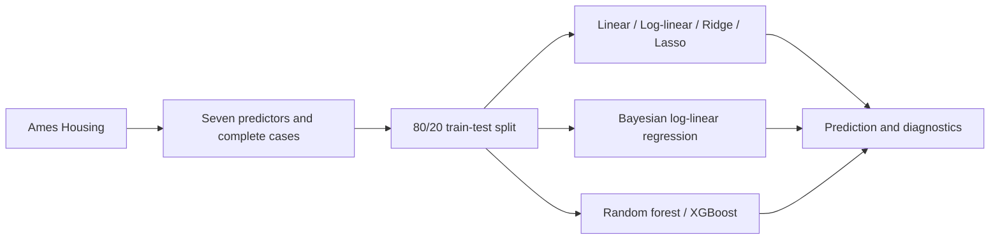

<div align="center">

# Tricast

### Housing price prediction through three statistical perspectives

**Frequentist inference · Bayesian uncertainty · Machine learning**

[Read the report](reports/Tricast.pdf) · [Explore the analysis](analysis/Tricast.Rmd) · [Reproduce the study](#reproduce-the-study)

<p align="center">
  <a href="https://www.r-project.org/"></a>
  &nbsp;&nbsp;
  <a href="https://pkgs.rstudio.com/rmarkdown/"></a>
  &nbsp;&nbsp;
  <a href="https://www.tidyverse.org/"></a>
  &nbsp;&nbsp;
  <a href="https://paulbuerkner.com/brms/"></a>
  &nbsp;&nbsp;
  <a href="https://xgboost.ai/"></a>
</p>

</div>

---

## Overview

This independent project was completed by **Jimmy Wu** while a student at the **University of California, Santa Barbara (UCSB)**, working with **Dr. Dawn E. Holmes**.

Tricast compares statistical and machine learning approaches to **housing price prediction**, asking how predictive accuracy, interpretability, and uncertainty change across modeling frameworks.

Using the **Ames Housing dataset** with 2,930 records and 82 attributes, the analysis selects seven housing characteristics and studies ordinary and log-linear regression, ridge and lasso, Bayesian regression, random forests, and gradient boosting. The [36-page report](reports/Tricast.pdf) follows the process from exploratory analysis to residual diagnostics, posterior checks, and model comparison.

[Methods](#methods) · [Results](#results) · [Reproduction](#reproduce-the-study) · [Repository guide](#repository-guide) · [Scope](#scope-and-interpretation)

## Study design



The predictors are overall quality, above-ground living area, garage capacity, garage area, basement area, first-floor area, and year built. Rows missing any selected variable are removed with `na.omit`; the initial split uses seed `20250929`.

## Methods

| Perspective | Models and tools | What the analysis examines |
|:---|:---|:---|
| Frequentist | `lm`; ridge and lasso via `glmnet` | Coefficients, residual assumptions, log transformation, cross-validated penalties |
| Bayesian | Log-price regression via `brms` | Priors, posterior coefficients, credible intervals, posterior predictive checks |
| Machine learning | Random forest via `ranger`; boosting via `xgboost` | Nonlinear prediction, held-out errors, variable importance |

## Results

The existing report's cross-model table (Table 19) gives these results on the **original dollar scale**:

| Model | Test RMSE ($) ↓ | Test MAE ($) ↓ | Reported R² ↑ |
|:---|---:|---:|---:|
| Log-linear, back-transformed | 30,050 | 20,350 | 0.8761 |
| Bayesian, back-transformed | 30,040 | 20,350 | 0.8761 |
| Random forest | 28,100 | **18,950** | **0.8893** |
| XGBoost | **27,850** | 19,090 | 0.8863 |

XGBoost has the lowest recorded RMSE; random forest has the lowest MAE. Both tree models place substantial importance on overall quality and above-ground living area. Bayesian regression adds posterior uncertainty summaries alongside predictive comparisons.

**Metric context:** ridge and lasso are evaluated on **log sale prices** in the notebook, so their RMSE and MAE are omitted from this dollar-scale table. The reported test R² values use squared prediction–outcome correlation; the notebook also reports a separate Bayesian R². See the [full report](reports/Tricast.pdf) for those distinctions and the original tables.

## Reproduce the study

The report can be read directly. To rerun the analysis:

1. Clone this repository and open R in its root directory.

   ```sh
   git clone https://github.com/JimmyWu-312/Tricast.git
   cd Tricast
   ```

2. Place the Ames Housing CSV at `data/AmesHousing.csv`. See the [data guide](data/README.md) for the expected columns and source details.

3. Install the packages loaded by the notebook, plus the renderer:

   ```r
   install.packages(c(
     "rmarkdown", "tidyverse", "knitr", "dplyr", "kableExtra", "glmnet",
     "brms", "ranger", "xgboost", "Matrix", "caret", "reshape2", "gridExtra"
   ))
   ```

4. Configure the Stan toolchain required by `brms`, and make Pandoc and LaTeX available. Then render from the repository root:

   ```r
   rmarkdown::render(
     "analysis/Tricast.Rmd",
     output_dir = "reports",
     knit_root_dir = getwd()
   )
   ```

RStudio supplies Pandoc; TinyTeX is one option for LaTeX (`tinytex::install_tinytex()` after installing the `tinytex` R package). Bayesian sampling requires compilation and may take time. Package versions are not pinned; the committed PDF records the original run, and newly generated results may differ.

## Repository guide

```text
Tricast/
├── analysis/
│   └── Tricast.Rmd      # Complete study, restored from the local project source
├── data/
│   └── README.md        # Dataset source and required CSV schema
├── reports/
│   └── Tricast.pdf     # Existing rendered study
└── README.md
```

## Scope and interpretation

- This is a comparative study of one city's housing data, using seven selected predictors and a single random holdout. Results do not establish performance in other markets or future periods.
- Predictor selection follows exploratory correlations on the full dataset. The holdout is not a fully isolated test of the entire feature-selection process.
- Log-scale and dollar-scale errors must be kept separate. Back-transforming log predictions also affects how dollar-scale results should be interpreted.
- Feature importance and regression coefficients describe model associations; they do not establish causal effects of renovations or other interventions.

## Author, academic collaboration, and data credit

**Jimmy Wu** · [GitHub](https://github.com/JimmyWu-312)

**Academic collaboration:** Dr. Dawn E. Holmes, University of California, Santa Barbara.

The report credits **De Cock (2011)** for the Ames Housing dataset. Full statistical and methodological references appear in the [report](reports/Tricast.pdf).
